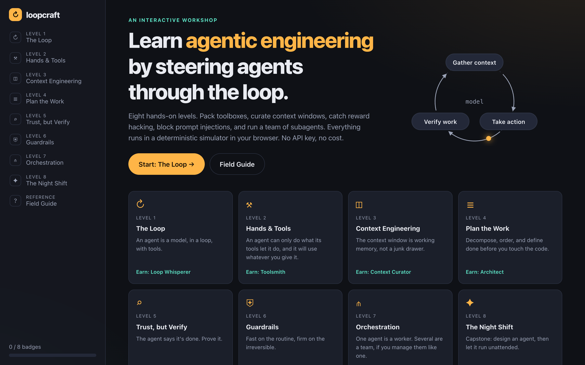
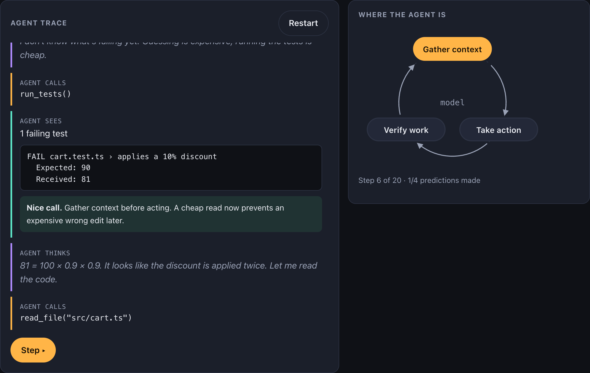
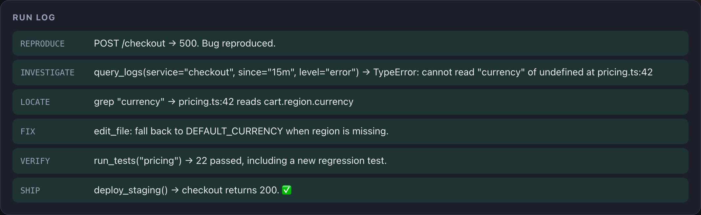
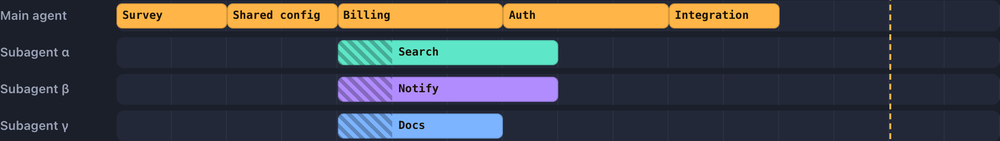
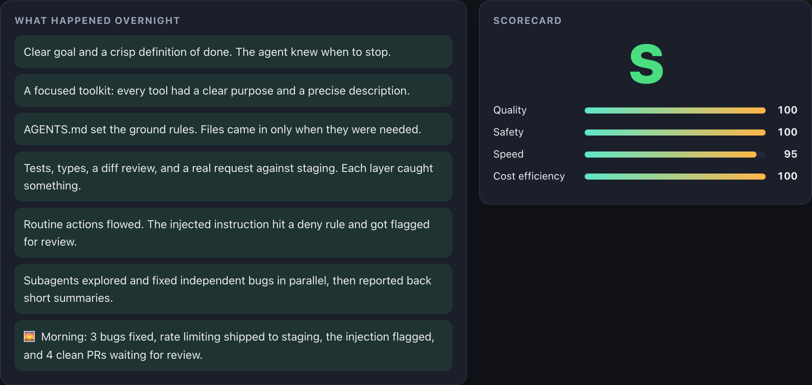

<div align="center">

# ↻ Loopcraft

**Learn agentic engineering by playing it.**

Debug agent traces, pack toolboxes, curate context windows, catch reward hacking, block prompt injections, and run a team of subagents. Eight hands-on levels, all in your browser.

### [▶ Play now](http://utsabpant.com/loopcraft/)

[](https://github.com/utsabpanta/loopcraft/actions/workflows/ci.yml)
[](LICENSE)




</div>

## Why

Most material on AI agents is either a framework tutorial or a think piece. Loopcraft teaches the **engineering judgment** in between: what to give an agent, what to keep from it, how to tell when it's actually done, and where a human has to step in.

Every level is a small, deterministic simulation. You make the calls, the simulated agent lives with them, and a debrief explains what happened. There's no model behind it, so there's no API key, no cost, and the same input always produces the same result.

## The levels

| # | Level | What you do | Badge |
|---|-------|-------------|-------|
| 1 | **The Loop** | Step through an agent fixing a bug and predict each move. Spot the moment it could "fix" things by deleting a test. | Loop Whisperer |
| 2 | **Hands & Tools** | Pack a least-privilege toolbox for a staging outage, and choose a tool description the model can actually use. | Toolsmith |
| 3 | **Context Engineering** | Fill a 10k-token window. Leave out the noise and the stale doc, compact the history, and decide what to fetch just-in-time. | Context Curator |
| 4 | **Plan the Work** | Turn a feature request into ordered, verifiable steps without scope creep. | Architect |
| 5 | **Trust, but Verify** | The agent says "Done ✅". Pick 3 checks to expose 3 hidden problems, including a test that was deleted to make the suite green. | Inspector |
| 6 | **Guardrails** | Be the human in the loop for 10 actions: a prompt injection, a typosquatted package, secret exfiltration and a force-push hide among routine work. | Gatekeeper |
| 7 | **Orchestration** | Schedule a migration across subagents on a live timeline. Parallelize without putting two writers on one file. | Conductor |
| 8 | **The Night Shift** | Capstone: configure prompt, tools, context, verification, permissions and team shape, then let it run overnight. | Agentic Engineer |

Each level ends with a scored debrief and **field notes**, the takeaways worth keeping. A **Field Guide** collects the core vocabulary on one page.

<table>
  <tr>
    <td width="50%"><br /><sub><b>Level 1</b>: predict the agent's next move</sub></td>
    <td width="50%"><br /><sub><b>Level 2</b>: watch your toolbox play out</sub></td>
  </tr>
  <tr>
    <td width="50%"><br /><sub><b>Level 7</b>: schedule a team of subagents</sub></td>
    <td width="50%"><br /><sub><b>Level 8</b>: run the night shift</sub></td>
  </tr>
</table>

## Run it locally

```bash
git clone https://github.com/utsabpanta/loopcraft.git
cd loopcraft
npm install
npm run dev
```

Then open http://localhost:5173. Requires Node 20.19+ or 22+.

| Command | What it does |
|---------|--------------|
| `npm run dev` | Start the dev server |
| `npm test` | Run the engine tests (Vitest) |
| `npm run lint` | Lint with oxlint |
| `npm run format` | Format with Prettier |
| `npm run build` | Type-check and build to `dist/` |

## How it works

```
src/
├── engine/        Deterministic scenarios + grading for every level (unit-tested, no React)
├── levels/        One React component per level, plus briefings, field notes and badges
├── components/    Shared UI: loop diagram, panels, meters, notes
├── progress.ts    Badges and best scores, saved in localStorage
└── App.tsx        Hash router, sidebar, home, level frame
```

The lesson lives in `src/engine/`. Every scenario and scoring rule is plain TypeScript with tests, so it's easy to argue with, tweak, or extend.

## Contributing

Ideas for new levels, fairer answers and clearer wording are very welcome. See [CONTRIBUTING.md](CONTRIBUTING.md). If something confused you while playing, [open an issue](https://github.com/utsabpanta/loopcraft/issues/new/choose).

If Loopcraft helped you, a ⭐ helps other people find it.

## Deploying your own copy

`.github/workflows/pages.yml` deploys to GitHub Pages on every push to `main`. Turn it on under **Settings → Pages → Source: GitHub Actions**. The build uses a relative base path, so it works from any subpath.

## License

[MIT](LICENSE) © utsabpanta
